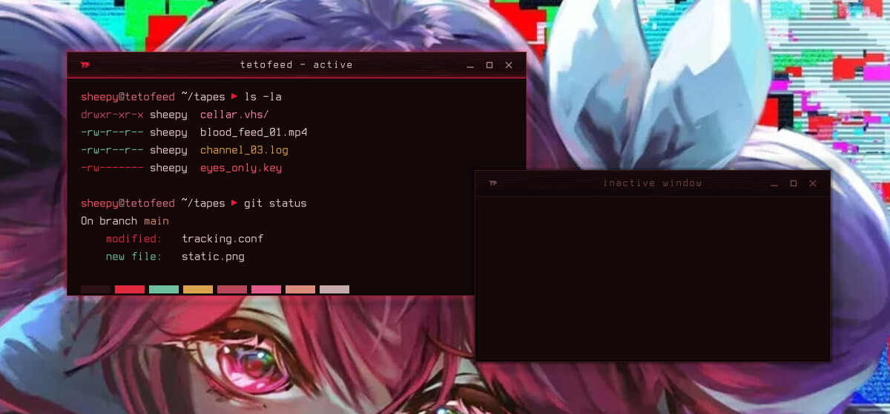
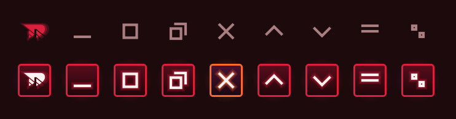

# Tetofeed — Aurorae Window Decoration

A blood-black VHS window frame: a scanline title bar with tape-grain streaks, a crimson glow seam, a crimson-glow shadow and VCR transport buttons.



Tetofeed is a red twindrilled VHS look for KDE Plasma 6, built around a crimson-lit face on near-black: blood-black surfaces, faint scanlines and tape grain, and a slight crimson glow on whatever has focus.

## Features

- Title bar with faint scanlines and tape grain that stretches into horizontal VHS streaks.
- A crimson glow seam under the title, with a hot 1 px core.
- The active window casts a soft crimson glow; inactive windows dim to blood-black with a plain shadow.
- Square transport-style buttons that light up crimson on hover (close glows REC scarlet). The window-menu button is a VCR `▶ PLAY` triangle.
- Centred title, 3 px borders, no rounded corners.



## Requirements

KWin (Plasma 6) with Aurorae.

## Install

```bash
git clone https://github.com/sheepy1335/tetofeed-aurorae
cd tetofeed-aurorae && ./install.sh
```

Or from the KDE Store: System Settings → Colors & Themes → Window Decorations → Install from File, or extract to `~/.local/share/aurorae/themes/`.

## The rest of the suite

| piece | repo |
|---|---|
| SDDM login | [tetofeed-sddm](https://github.com/sheepy1335/tetofeed-sddm) |
| Plymouth boot splash | [tetofeed-plymouth](https://github.com/sheepy1335/tetofeed-plymouth) |
| Global theme + splash screen | [tetofeed-global](https://github.com/sheepy1335/tetofeed-global) |
| Plasma style (panel, popups) | [tetofeed-plasma](https://github.com/sheepy1335/tetofeed-plasma) |
| Colour scheme | [tetofeed-colors](https://github.com/sheepy1335/tetofeed-colors) |
| Kvantum widget style | [tetofeed-kvantum](https://github.com/sheepy1335/tetofeed-kvantum) |
| Icon theme | [tetofeed-icons](https://github.com/sheepy1335/tetofeed-icons) |
| Konsole + kitty colours | [tetofeed-konsole](https://github.com/sheepy1335/tetofeed-konsole) |

Everything at once, with the generators: [tetofeed](https://github.com/sheepy1335/tetofeed).

## Tags

`tetofeed` `kde` `plasma6` `dark` `vhs` `scanlines` `crimson` `red` `blood` `horror` `retro` `analog-horror` `glow` `aurorae` `window-decoration` `kwin` `titlebar` `vcr-buttons`

## Credits and licence

By sheepy1335. GPL-3.0-or-later.
